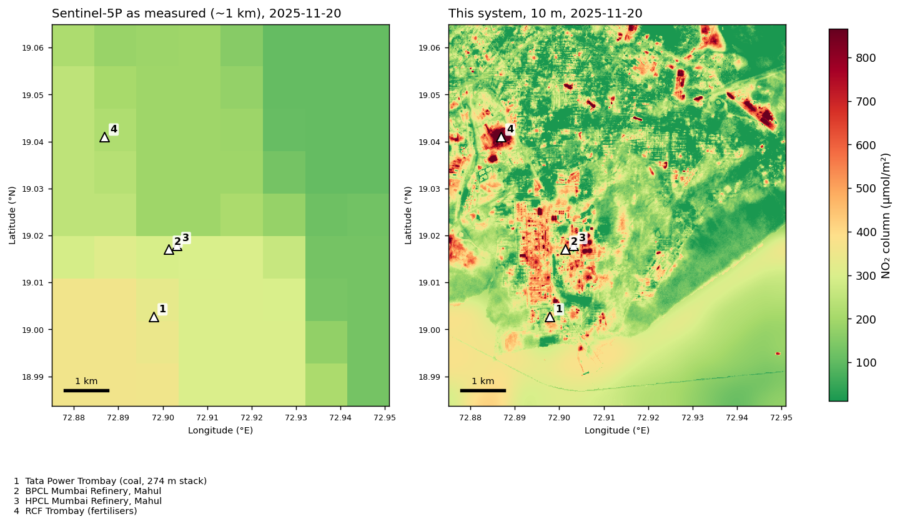

# 🌍 AI-Powered Multi-Pollutant Mapping for Hyperlocal Air Quality Monitoring

> **1st Place & ₹1.5L Grant Winner – Climate Hackathon 2024**  
> *Issued by the U.S. Consulate General Mumbai & Ekonnect Knowledge Foundation*


---

## 📌 Project Overview

Urban air pollution monitoring often suffers from a critical data scarcity issue: satellite instruments like **Sentinel-5P** provide essential atmospheric pollution data, but at a coarse resolution (~1000m), making it difficult to pinpoint neighborhood-level hotspots.

This project implements a **domain-agnostic "Super-Resolution" AI pipeline** that fuses coarse-resolution Sentinel-5P atmospheric data with high-resolution **Sentinel-2** surface imagery. Powered by **Convolutional Neural Networks (CNNs)** and statistical correlation techniques, the system downscales pollution maps to **10m spatial resolution**, enabling data-driven, hyperlocal environmental action.

**How it works:**
1. Sentinel-5P gives the concentration of each pollutant in ~1 km blocks.
2. Sentinel-2 gives the surface at 10 m: blue, green, red and near-infrared bands, plus NDVI (vegetation) and NDWI (water).
3. The model learns how each pollutant correlates with those surface signals across the 1 km blocks of many overpasses.
4. It applies that relationship to every 10 m pixel.
5. A final step matches the 10 m map to that day's satellite reading as the satellite actually sees it. Sentinel-5P's real
   ground pixel is ~5.5 × 3.5 km, so the map, averaged over that footprint, must reproduce the observation
   (details: docs/ARCHITECTURE.md).

**Live system: [hyperlocal-air-quality.onrender.com](https://hyperlocal-air-quality.onrender.com)** · pick a pollutant, a date and an area of Mumbai, and the server fetches the real Sentinel data from Google Earth Engine and returns the 10 m map, hotspots and a GeoTIFF.
(Free hosting: the first visit after ~15 idle minutes takes about a minute to wake the server.)

---

## ⚡ Key Features

* **100x Resolution Enhancement:** 1 km Sentinel-5P → 10 m maps (25–40 m for the whole city in one go), consistent with the satellite at 1 km.
* **Live Multi-Source Data Fusion:** Sentinel-5P (TROPOMI, OFFL with NRTI fallback) and cloud-masked Sentinel-2 L2A composites, pulled on demand from Google Earth Engine on one aligned 10 m / 1 km grid; Landsat-8 fallback.
* **Six Pollutants:** NO₂, SO₂, CO, HCHO, O₃ and the UV aerosol index.
* **Model Choice:** linear regression on Sentinel-2 bands, multi-scale regression, random forest, and a **hybrid regression + CNN** whose CNN is trained with an aggregation loss through the real Sentinel-5P footprint (~5.5 × 3.5 km).
* **Cloud-Gap Handling:** inverse-distance filling of cloudy blocks; seasonal decomposition for long gaps.
* **Independently Tested:** against NASA airborne NO₂ column maps (New York, LISTOS 2018, 60 tiles), with the results, good and bad, reported in full.
* **Actionable Output:** ranked 10 m hotspots and downloadable GeoTIFFs for GIS tools.
* **Extensible & Domain-Agnostic Architecture:** the same downscaling core can be retrained for crop health, flood risk or urban heat islands.

---

## 📅 Training and validation period

| | Period |
|---|---|
| **Training** | dry seasons (1 Nov – end of Feb) **2022-23, 2023-24, 2024-25** |
| **Validation (held out)** | dry season **2025-26** (1 Nov 2025 – 28 Feb 2026) |

Why this window:
1. **One data version.** The Sentinel-5P NO₂ processor was upgraded several times; version changes raised tropospheric NO₂ by ~38 % (v1.4) and ~14 % (v2.2), and mixing versions creates artificial jumps (Zhang et al., EGUsphere 2023; van Geffen et al., AMT 2022). From November 2022 on, data come from the current processor (v2.4, released July 2022).
2. **No COVID-19 distortion.** Mumbai's NO₂ fell by ~40–50 % during the 2020 lockdown (ESA, April 2020); 2020–21 would be an outlier, not today's city.
3. **Dry season only.** Monsoon cloud (Jun–Sep) leaves few usable overpasses and blurs Sentinel-2 composites; November–February has the clearest skies and the strongest, most stable spatial pollution patterns (winter inversions trap emissions near their sources).
4. **Recent and multi-year.** Three seasons give enough overpasses while reflecting today's roads, construction and industry.
5. **Honest test.** The 2025-26 season is never used in training, so validation on it is out-of-sample.

Sentinel-5P has only flown since late 2017, so earlier years don't exist for this sensor. Maps can be made for any date since 2018, but they are most reliable for dry-season dates; monsoon maps rest on few cloud-free overpasses.

## 🧠 Training results (real Sentinel data)

Trained on 6 areas of Mumbai (~450 km² at 10 m) × 3 dry seasons (2022-23, 2023-24, 2024-25) = 18 area-seasons,
~90–120 Sentinel-5P overpasses each, 600 steps per pollutant. The score is the mean daily correlation between each
model's map (as Sentinel-5P would see it, through its ~5 × 4 km footprint) and the real observation of that day:

| Pollutant | Area-days | Regression alone | **Hybrid regression + CNN** |
|---|---|---|---|
| NO₂ | 2000 | 0.372 | **0.398** |
| Aerosol index | 2153 | 0.392 | **0.400** |
| CO | 1656 | 0.093 | **0.107** |
| O₃ | 2153 | 0.077 | **0.080** |
| HCHO | 2092 | 0.057 | **0.060** |
| SO₂ | 2004 | 0.052 | **0.054** |

The CNN correction improves on the regression for every pollutant. NO₂ and aerosols are clearly tied to what Sentinel-2 sees on the ground (roads, industry, built-up areas, bare land), so their 10 m detail is the most meaningful. For CO, O₃, HCHO and SO₂, Sentinel-5P's pattern within a city is weak or noisy (CO and O₃ are long-lived and regionally mixed, SO₂ and HCHO are near the instrument's detection limit), so their 10 m maps mostly carry the satellite's own pattern with modest surface-based detail. Independent accuracy checks, including NASA airborne maps, are in the Validation section.

---

## 📊 Validation

**Why validating this is hard.** Sentinel-5P measures the *column*, i.e. all the NO₂ (or SO₂, CO, …) in the air above a point, from the ground to the top of the atmosphere. Ground monitors measure the *surface concentration*, i.e. the air at nose height. The two are related only loosely: the link changes with wind, mixing height and time of day, and a monitor next to a road reads differently from one 200 m away. So the right yardstick for a 10 m column map is an independent **high-resolution column measurement**. Only aircraft carrying imaging spectrometers provide one.

Four checks, all from publicly available data, with no sensors built (full method: **[docs/VALIDATION.md](docs/VALIDATION.md)**):

<!-- AUTO:headline -->
| Check | Truth | Headline result |
|---|---|---|
| **1. NASA airborne NO₂ maps (New York)** | independent column maps at 250 m | With no New York training, the Mumbai-trained CNN is **on par with interpolation at 250 m** (33/60 tiles) and **slightly better than it at 1 km** (37/60 tiles, r 0.50 → 0.53) |
| **2. Up-scaling test (Mumbai, 6 pollutants)** | real Sentinel-5P at 1 km | CNN adds detail for **every pollutant**: skill **+0.09 to +0.13** over interpolation on a held-out season |
| 3. Simulated scene | known 10 m field | CNN recovers hotspot classes best for 5 of 6 pollutants |
| 4. Surface monitoring stations | CPCB / MPCB monitors | no method, including the raw satellite, tracks station readings (r ≤ 0.1). Documented below, not used as an accuracy claim |
<!-- /AUTO:headline -->

### 1. Independent truth: NASA airborne NO₂ column maps over New York

No aircraft has mapped NO₂ columns over Mumbai. In summer 2018 NASA's LISTOS campaign flew the **GCAS** imaging spectrometer over New York City during Sentinel-5P overpasses and mapped the NO₂ column at ~250 m. Independent ground spectrometers (Pandora) agree with these maps to r² = 0.92 (Judd et al., AMT 2020).

<!-- AUTO:airborne -->
I ran the system unchanged on New York for 10 afternoon flights (2 Jul, 19 Jul, 20 Jul, 6 Aug, 15 Aug, 16 Aug, 24 Aug, 28 Aug, 29 Aug, 6 Sep 2018). 5 Aug had no Sentinel-5P overpass in Earth Engine. For 6 Sep NASA's WRF-Chem column is empty, so the NAM-CMAQ version of the aircraft column is used. It ran on 60 tiles of 8 × 8 km covered by the aircraft at 10 m, and the maps were averaged to the aircraft's 250 m grid. **The CNN is the one trained on Mumbai; no New York or aircraft data was used to train or tune anything.** The aircraft data is used only for scoring.

| Method | r at 250 m (all 60 tiles) | r at 1 km (all) | **r at 250 m (30 resolved tiles)** | r at 1 km (resolved) | Beats interpolation (all / resolved) |
|---|---|---|---|---|---|
| Sentinel-5P as is (1 km) | 0.28 | 0.48 | 0.55 | 0.67 | – |
| Interpolation (bilinear) | 0.29 | 0.50 | 0.57 | 0.70 | – |
| Linear regression | 0.30 | 0.51 | 0.45 | 0.65 | 28/60 / 7/30 |
| Multi-scale regression | 0.27 | 0.49 | 0.46 | 0.63 | 24/60 / 4/30 |
| **Hybrid regression + CNN** | **0.28** | **0.53** | **0.53** | **0.73** | **33/60 / 13/30** |

*Resolved tiles* are those where the raw 1 km satellite itself tracks the aircraft pattern (r ≥ 0.3). The selection depends only on the satellite, not on any downscaling method.

What it shows:
- **At 250 m the Mumbai-trained CNN is on par with interpolation** in New York: it wins 33 of 60 tiles (sign test p = 0.26), median r 0.28 vs 0.29. Its 10 m detail does not transfer reliably to a different city and season.
- **At 1 km it is slightly better than interpolation:** 37 of 60 tiles (p = 0.046), median r 0.53 vs 0.50.
- **Where the satellite already matches the aircraft well** (30 tiles), interpolation is hard to beat: r at 250 m is 0.53 for the CNN vs 0.57 for interpolation, and 0.73 vs 0.70 at 1 km. On some of these tiles the surface-based detail moved NO₂ to the wrong places.
- **Regression alone does worse than interpolation,** in New York as in Mumbai.
- **The level is right:** Sentinel-5P reads ~0.94× the aircraft column, consistent with the known low bias of the 2018 product.
- **More data changed the picture.** The first 3 flights alone (18 tiles) suggested a clear win, but the full 10 flights do not. That is why the larger sample is the one reported.

Limits, stated plainly:
- **On 30 of 60 tiles the raw satellite itself does not track the aircraft** (r < 0.3), mostly clean or patchy days. No method can add a pattern the satellite does not contain.
- **Detail inside each 1 km cell is weakly predicted** (r ≈ 0.06 vs 0.09 for interpolation, resolved tiles). The maps are also smoother than reality, with ~44–59 % of the aircraft's contrast.
- **Sub-1 km detail:** the CNN wins 33/60 tiles (p = 0.26), i.e. no reliable gain.
- **A different city and year** (New York, 2018, an older Sentinel-5P processor with a 7 × 3.5 km pixel). This tests the **method**, not Mumbai's maps specifically.
- **Shared surface artifacts are possible:** NASA notes that parks and bright buildings can leave small artifacts in the aircraft retrieval, and our model also uses surface brightness.
<!-- /AUTO:airborne -->

Reproduce: `python validation/airborne/airborne.py extract`, then `python validation/airborne/airborne.py compare` (download steps in docs/VALIDATION.md). Results: `validation/results/airborne_NO2.json`. The tables on this page are filled from the result files (`python validation/report.py`; it runs automatically after each validation).

### 2. Up-scaling test on real Sentinel-5P (Mumbai, held-out 2025-26 season)

Real 1 km Sentinel-5P is averaged to 4 km, downscaled back to 1 km with each method, and compared with the real 1 km values. *Detail r* scores only the detail inside each 4 km block, i.e. the part the method had to supply.

<!-- AUTO:upscaling -->
| Pollutant | Detail r: interpolation | **Detail r: CNN** | **CNN skill vs interpolation** | Linear regression skill |
|---|---|---|---|---|
| NO₂ | 0.51 | **0.60** | **+0.09** | −0.15 |
| SO₂ | 0.40 | **0.58** | **+0.12** | +0.11 |
| CO | 0.45 | **0.60** | **+0.12** | −0.04 |
| HCHO | 0.40 | **0.58** | **+0.11** | +0.11 |
| O₃ | 0.39 | **0.59** | **+0.13** | +0.12 |
| Aerosol index | 0.47 | **0.57** | **+0.10** | −0.09 |
<!-- /AUTO:upscaling -->

Skill = 1 − RMSE / RMSE(interpolation), so above 0 means better than interpolation. This test assumes that the relation learned from 4 km to 1 km also holds from 1 km to 10 m. That assumption is why check 1 matters.

`python validation/validate.py upscaling --pollutant all --end 2026-02-28`

### 3. Simulated scene with a known 10 m field

This is a controlled test of whether a method can recover 10 m detail at all, on an idealised satellite whose cells are true 1 km averages. The table shows hotspot-class accuracy, i.e. the share of pixels in the right class:

| Pollutant | Interpolation | Linear regression (original) | Multi-scale regression | **CNN** |
|---|---|---|---|---|
| NO₂    | 70.3 % | 69.1 % | 76.1 % | **76.2 %** |
| SO₂    | 75.9 % | 45.0 % | 51.9 % | **77.3 %** |
| CO     | 63.2 % | 63.1 % | 65.0 % | **67.1 %** |
| HCHO   | 75.3 % | 64.1 % | 72.7 % | **78.9 %** |
| O₃     | 67.6 % | 64.1 % | 66.6 % | **68.2 %** |
| Aerosol index | 66.9 % | 72.7 % | **78.7 %** | 76.9 % |

With a realistic ~5 × 4 km Sentinel-5P footprint, the footprint-aware methods reach 70–73 % versus 52 % for interpolation (R² ≈ 0.75 vs 0.24); see docs/ARCHITECTURE.md.

### 4. Surface monitoring stations (documented for completeness)

The maps were compared with Mumbai's CPCB/MPCB monitors (via OpenAQ) at the Sentinel-5P overpass time, 13:00–15:00 IST, for the held-out 2025-26 season. The table shows the median daily correlation across stations:

<!-- AUTO:ground -->
| Pollutant | Stations / readings | Sentinel-5P as is | Interpolation | CNN | CNN skill vs raw satellite |
|---|---|---|---|---|---|
| NO₂ | 29 / 2248 | 0.09 | 0.12 | 0.10 | −0.01 |
| SO₂ | 27 / 2119 | 0.06 | 0.04 | 0.03 | 0.00 |
| CO | 28 / 1507 | −0.02 | −0.03 | −0.04 | 0.00 |
| O₃ | 29 / 2192 | 0.00 | −0.01 | −0.07 | 0.00 |
| Aerosol index (vs PM2.5) | 29 / 2534 | 0.05 | 0.06 | −0.01 | 0.00 |
<!-- /AUTO:ground -->

**Finding:** nothing tracks the stations. That includes the raw satellite, which the downscaling cannot be expected to beat on this test. This is a property of the comparison, not of the method:
- column ≠ surface;
- most stations sit next to roads or inside compounds;
- neighbouring stations often disagree with each other.

The CO "AQI-band accuracy" of 100 % in the result file is meaningless: every reading falls in the *Good* band. I keep this check to show it was done and why it is not the right yardstick for column maps.

`python validation/validate.py ground --pollutant NO2 --start 2025-11-01 --end 2026-02-28` (needs a free OpenAQ key)

### What did not work, and what changed because of it

- **A plain CNN trained on small windows learned nothing on real data.** Sentinel-5P's pixel (~5.5 × 3.5 km) is larger than the windows, so the target carried no usable within-window signal. I replaced it with a **hybrid**: a regression base plus a CNN correction, trained on whole areas through the satellite's real footprint.
- **A per-day contrast fit often came out zero or negative,** so the map fell back to plain interpolation. I replaced it with one season-level pattern strength.
- **The original hackathon method (linear regression on Sentinel-2 bands) is worse than interpolation on real data** for NO₂, CO and aerosol index (checks 1 and 2). It is kept in the app for comparison only.
- **Early maps had negative values and streaks over the sea.** I added a non-negative floor and a water mask from Sentinel-2 (NDWI).
- **Ground stations showed no skill** (check 4). This is why I turned to aircraft column data for validation.

### Next steps

<!-- AUTO:airborne_next -->
- **Train on more cities and seasons.** In New York the Mumbai-trained model's fine detail did not transfer reliably; training on several cities (and the summer season) is the most direct way to make it general.
- **Other airborne campaigns over different cities** that overlap Sentinel-5P, to test any retrained model independently.
<!-- /AUTO:airborne_next -->
- **A separate surface-concentration model** (satellite + meteorology + land use, validated leave-one-station-out). This is the right tool if the goal is "what people breathe" rather than the column.

---


## 🏭 Case study: Chembur – Trombay – Mahul

Mumbai's main industrial belt (a coal power station, two refineries and a fertiliser complex) spans only a few
Sentinel-5P pixels. The 10 m maps place the high NO₂ values on the industrial plots instead of spreading them over the
surrounding homes, mangroves and bay. They do this while still reproducing what the satellite measured.



Details, the season average, the numbers for each site and how to read them (including caveats): **[docs/CASE_STUDY.md](docs/CASE_STUDY.md)**.

---

## 🛠️ Tech Stack

* **Core & ML:** Python, NumPy, SciPy, scikit-learn, CNN (NumPy implementation + TensorFlow/Keras for GPU training)
* **Geospatial & Remote Sensing:** Google Earth Engine (GEE) API, Sentinel-5P, Sentinel-2, Landsat-8
* **Backend & API:** Flask, REST APIs, background jobs, GeoTIFF export
* **Frontend Dashboard:** React.js, Leaflet
* **Deployment:** Docker, Render (blueprint included)

---

## 🗂️ Repository layout

```
backend/
  app.py              REST API (also serves the built dashboard)
  train.py            train the CNN on live Sentinel data → backend/models/
  hyperlocal_aq/      gee.py (data) · core.py · models.py · pipeline.py · service.py (jobs)
                      metrics.py · render.py · export.py (GeoTIFF) · timeseries.py
                      ground.py (OpenAQ/CSV stations) · validation.py (collocation, metrics) · scene.py
  tests/              pytest (Earth Engine mocked)
frontend/             React + Leaflet dashboard (Vite)
validation/           validate.py (ground stations, up-scaling test), run_validation.py (simulation), results/
                      report.py (fills the README tables) · case_study/ (fetch.py, build.py)
                      airborne/airborne.py (NASA LISTOS airborne NO₂ comparison, New York)
gee/                  Earth Engine Code Editor scripts
notebooks/legacy/     original hackathon notebooks
docs/                 ARCHITECTURE.md · DEPLOY.md · VALIDATION.md
Dockerfile · render.yaml · docker-compose.yml
```

## 🚀 Run locally

```bash
# backend
cd backend
pip install -r requirements.txt
earthengine authenticate                 # once, with the Google account that owns the EE project
export GEE_PROJECT=<your-cloud-project-id>
python app.py                            # http://localhost:5000/api/health
pytest -q                                # unit + API tests (Earth Engine mocked)

# frontend (another terminal)
cd frontend
npm install
npm run dev                              # http://localhost:5173 (proxies /api to :5000)
```

Production deployment (Render): see **[docs/DEPLOY.md](docs/DEPLOY.md)**.

### API

| Method | Path | Notes |
|---|---|---|
| GET | `/api/health` | server and Earth Engine status |
| GET | `/api/pollutants` · `/api/methods` · `/api/areas` | catalogues and limits |
| POST | `/api/jobs` | `{"pollutant":"NO2","method":"mslr","date":"2025-01-15","area":"chembur_trombay"}` or `"bbox":[w,s,e,n]` → job id |
| GET | `/api/jobs/<id>` | progress, then map overlays, stats, hotspots, data provenance |
| GET | `/api/jobs/<id>/geotiff` | 10 m result (`coarse_geotiff` for the 1 km input) |
| GET | `/api/validation` | airborne, up-scaling, ground-station and simulation results |

---