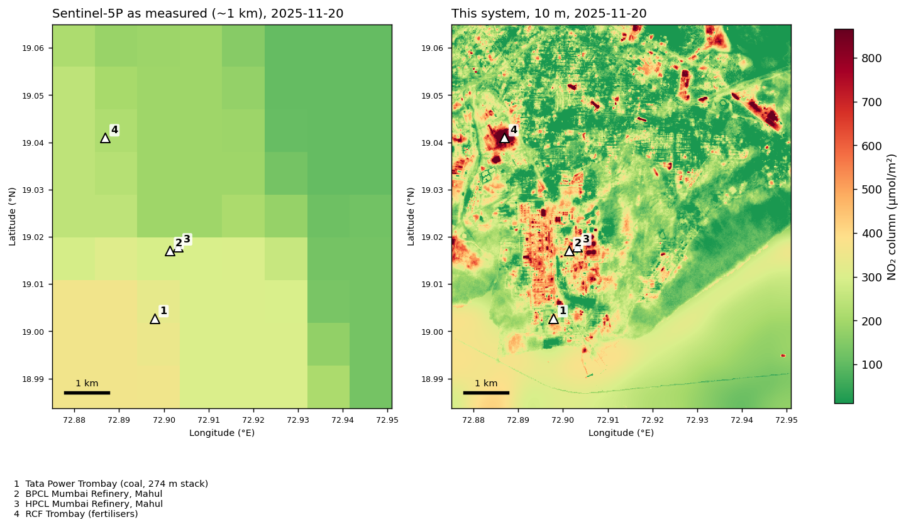
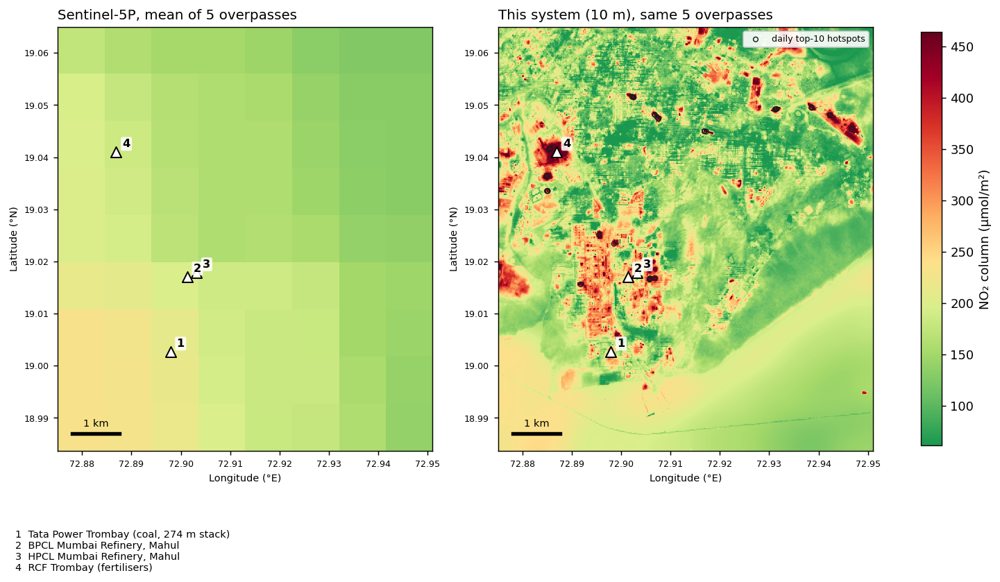

# Case study: Chembur – Trombay – Mahul, Mumbai

This is Mumbai's main industrial belt: a coal power station, two oil refineries and a fertiliser complex sit within about 4 km of each other, next to homes (the Mahul resettlement colony). At Sentinel-5P's resolution the whole belt is a handful of pixels. This page shows what the 10 m maps add there.

Maps were made by the live system (hybrid regression + CNN, NO₂) for 5 overpasses in the held-out 2025-26 dry season (2025-11-20, 2025-12-05, 2025-12-20, 2026-01-05, 2026-01-20), over the app's *Chembur · Trombay · Mahul* area at 10 m. Reproduce: `python validation/case_study/fetch.py`, then `python validation/case_study/build.py`.

## One day: 2025-11-20 (least cloud)

## Season average and recurring hotspots

Circles mark each day's ten strongest hotspots, as listed by the app.

## Known sources

The table compares each site's value with the rest of the area. *Percentile*: the share of the area with lower NO₂ than the site, from the season-mean maps. *× median*: the site's value relative to the area median. *Hotspot days*: days with an app hotspot within 1 km of the site.

| # | Site | Percentile at 1 km | **Percentile at 10 m** | × median at 1 km | **× median at 10 m** | Hotspot days |
|---|---|---|---|---|---|---|
| 1 | Tata Power Trombay (coal, 274 m stack) | 86 | **92** | 1.28 | **1.59** | 0/5 |
| 2 | BPCL Mumbai Refinery, Mahul | 81 | **92** | 1.20 | **1.59** | 5/5 |
| 3 | HPCL Mumbai Refinery, Mahul | 76 | **87** | 1.18 | **1.44** | 5/5 |
| 4 | RCF Trombay (fertilisers) | 67 | **100** | 1.12 | **3.39** | 5/5 |

## What the maps show

- **The 1 km map is a gentle gradient.** The whole industrial belt spans a few satellite pixels, and the sites sit at the 67th–86th percentile of the area. At 10 m they sit at the 87th–100th percentile: the map places the high values on the industrial plots themselves rather than spreading them over homes, mangroves and the bay.
- **RCF Trombay (fertilisers) stands out most** (3.4× the area median at 10 m vs 1.1× at 1 km).
- **Hotspot days:** Tata Power Trombay 0/5, BPCL Mumbai Refinery 5/5, HPCL Mumbai Refinery 5/5, RCF Trombay 5/5. A miss at Tata Power's chimney site fits a tall stack (see below).
- **It stays faithful to the satellite.** Each 10 m map, seen through the satellite's footprint, closely reproduces that day's Sentinel-5P observation (the app reports this as *satellite consistency*). The detail redistributes what the satellite measured; it does not add pollution.

Site locations: Global Energy Monitor (Tata Power, BPCL, RCF) and Climate TRACE (HPCL). They are single points; each site covers hundreds of metres.

## How to read this

- **This is an illustration, not a validation.** A hotspot next to a factory is *plausible*, not proof. The independent accuracy checks are in the README (NASA airborne maps, up-scaling test).
- **Tall stacks put NO₂ downwind.** Tata Power's 274 m chimney releases its plume high up and away from the site. The satellite sees the column above, so the peak can sit a kilometre or more from the plant.
- **Traffic matters too.** The Eastern Freeway, the Sion–Trombay road and port traffic also emit NO₂, so not every hotspot is industrial.
- **Bright bare or paved ground can also look hot.** The model links built-up, industrial and bare surfaces with NO₂, so some isolated hot patches away from known sources (e.g. in the north-east of the area) are likely bare land, yards or construction sites rather than emitters. Treat them as places to check, not findings.
- **The 10 m detail comes from the surface** (built-up, industrial and bare land vs vegetation and water). It sharpens where the satellite already sees pollution. It cannot discover a source the satellite misses.
